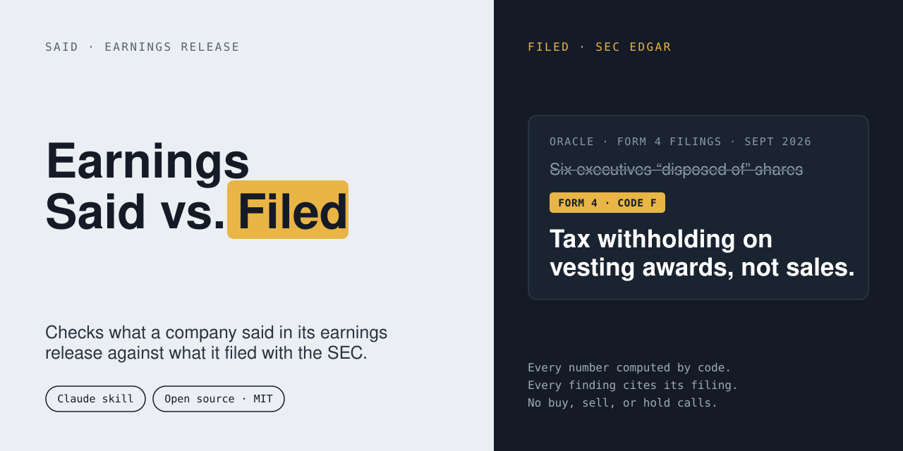

<p align="center">
  
</p>

<p align="center">
  <a href="LICENSE"></a>
  
  
</p>

# Earnings Said vs. Filed

A Claude skill that compares what a public company **said** in its earnings release with
what it **filed** with the SEC, then produces a one-page brief. Every number is computed
by code, and every finding cites the filing it came from.

> Informational only. Not investment advice. It never recommends buying, selling, or
> holding anything.

## Watch the walkthrough

[](https://youtu.be/dorHaN9kQCc "Earnings Said vs. Filed: how to use the skill")

**▶ [How to use the skill](https://youtu.be/dorHaN9kQCc)** shows the whole loop: ask about a
company's latest quarter, get a cited brief back.

## The problem

An earnings press release is written to be read quickly and favorably. The filings behind it
(10-Q, 8-K, Form 4) are where the details live, and they rarely get read side by side.
Headlines say executives "disposed of" shares; the Form 4 says the shares were withheld for
taxes on vesting. Revenue is up; the backlog is flat. A one-time gain is doing a lot of
the work in EPS.

This skill does that comparison and shows its sources.

## What it catches

These come from real September 2026 filings:

| Company | What the filings show |
|---|---|
| **Oracle** | Six executives "disposed of" shares on the same day. All six were tax withholding on vesting awards (Form 4 code **F**), not sales. The one actual sale was under a pre-arranged plan, and a separate 8-K disclosed a trading-plan termination that never appears on a Form 4. |
| **NVIDIA** | Operating income and net income grew at very different rates quarter over quarter, and the 10-Q notes a segment recast. |
| **Adobe** | Backlog stayed level across three quarters of rising revenue. |
| **Broadcom** | Actual revenue versus the prior quarter's guidance, from two 8-Ks alone. |
| **Lululemon** | A one-time item's share of reported EPS, and a guidance cut. |

## How it stays honest

- **Numbers never come from the model.** Prose uses placeholders and code fills them in. The
  validator blocks any digit a model typed.
- **Provenance is enforced.** A "Filed" confidence tag requires an SEC accession number.
  Anything else is labeled *Secondary-Unverified*.
- **Fails closed.** Banned language, missing citations, or untraceable numbers block the
  brief instead of shipping it with a warning.
- **Insider codes, not "buy/sell."** Form 4 transactions are classified by transaction code,
  with no arbitrary cluster threshold.
- **No advice, by design.** Requests for buy, sell, or hold calls are refused.

## Install

**Claude:** zip the folder so `earnings-reality-check/` sits at the root of the archive, then
upload it under Settings → Skills. Code execution must be enabled.

```bash
git clone https://github.com/bryanG2518/earnings-said-vs-filed.git earnings-reality-check
zip -r earnings-reality-check.zip earnings-reality-check -x "*/.git/*"
```

**Claude Code:** clone it into your skills folder.

```bash
git clone https://github.com/bryanG2518/earnings-said-vs-filed.git ~/.claude/skills/earnings-reality-check
pip install edgartools
```

Live fetching needs an identity, because the SEC requires automated clients to say who they
are. Use any real contact address you can receive mail at:

```bash
export EDGAR_IDENTITY="Your Name you@example.com"
```

## Use

Ask in plain language:

```
What really happened in Oracle's latest quarter? Compare the release to the filings.
```

```
Did NVIDIA's insiders sell around earnings, or is that just tax withholding?
```

```
Show me anything unusual in Lululemon's guidance this quarter.
```

You get a one-page brief: findings ordered by materiality, each with its filing citation, plus
a short glossary for readers who don't live in EDGAR.

## Run it from the command line

```bash
cd scripts
python -m ercheck.cli --input ../tests/fixtures/orcl_q1fy27.json
python -m ercheck.cli --input ../tests/fixtures/lulu_q2fy26.json --lang es
```

Tests and evaluation:

```bash
python -m unittest discover -s tests -v
python eval/run_eval.py --split dev
```

## Evaluation status

Thresholds were set before any results existed (`eval/thresholds.json`): 100% numeric
accuracy, per-finding precision of at least 90% and recall of at least 80% on a held-out set,
and a false-alarm rate under 10% on quiet quarters.

**Current state:** 5 real development quarters plus 1 synthetic control, labeled by the rules'
author. They pass, but that is a smoke test, not evidence. The held-out set (15 quarters) and
20 quiet controls are not built yet. Results will be published here whether they pass or fail.

**Live EDGAR check:** the live fetch path was run against NVIDIA's latest 10-Q on 2 November
2026. All eight tracked fields resolved from SEC data, using 3 of the 25 requests allowed per
run.

## Scope (v1)

US domestic 10-Q and 10-K filers. Not banks, insurers, REITs, or foreign private issuers. It
respects the SEC's fair-access rules: declared identity, 5 requests per second, and 25
requests per run.

## Known limitations

- Guidance and one-time items come from press-release exhibits and rely on exact-text
  extraction. Two of the five fixtures still carry press-sourced numbers and are labeled
  Secondary-Unverified until checked against EDGAR.
- Spanish output translates labels and the glossary, not the finding sentences.
- The eval set is small. Treat the scores as a regression check, not a claim of accuracy.

## Layout

```
.
├── README.md
├── SKILL.md                  the skill's instructions
├── LICENSE
├── requirements.txt
├── docs/
│   └── banner.svg            header image
├── scripts/ercheck/          fetch, compute, rules, validate, render
├── references/               input schema, stack notes
├── eval/                     labels, thresholds, runner
└── tests/                    unit tests and real-filing fixtures
```

## A note on use

This is a research aid for reading public filings. It is not a recommendation engine, and
nothing it produces is a basis for a trade. Verify anything that matters against the cited
filing.

## License

MIT, with an explicit no-advice notice. See [`LICENSE`](LICENSE).
